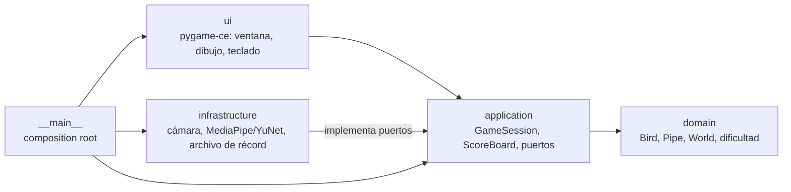

# 🐦 Flappy Bird – Control Facial


Versión del clásico Flappy Bird que se controla **moviendo la nariz** frente a la cámara.
El pájaro sigue la altura de tu nariz en tiempo real; esquiva los tubos para sumar puntos.

## ✨ Características

- **Seguimiento facial moderno**: MediaPipe Face Landmarker (malla de 478 puntos) ubica la
  punta real de la nariz. Si MediaPipe no está disponible, cae automáticamente a la red
  YuNet de OpenCV (modelo incluido, funciona sin internet).
- **Control suave y preciso**: filtro *One Euro* contra el temblor + calibración del rango
  de movimiento, así no hace falta estirar el cuello para llegar a los bordes.
- **Juego fluido a 60 FPS**: la cámara y la detección corren en un hilo aparte y la física
  usa tiempo real (`dt`), así la velocidad no depende de los FPS de la webcam.
- **Hitbox justa**: colisión círculo-rectángulo acorde al dibujo del pájaro.
- **Pausa automática** si se pierde el rostro o la ventana pierde el foco.
- **Pájaro vectorial animado**: dibujado con código (sin sprites). Aletea rápido al subir,
  tranquilo cuando se mantiene y planea con las alas levantadas al bajar; mira hacia donde va.
- **Escenario vectorial generado por código** (sin imágenes de fondo): cielo con degradé,
  sol, nubes, mar y pasto en capas con *parallax* que avanzan a la velocidad del juego. En
  cada nivel el día avanza hacia el atardecer con una transición suave de colores.
- **Dificultad progresiva**, récord persistente y vista previa de la cámara en pantalla.
- **Modo mouse** para jugar o probar sin cámara.

## 🎮 Controles

| Entrada | Acción |
|---|---|
| Nariz arriba / abajo | Mover el pájaro |
| Cualquier tecla / clic | Empezar (en el menú) |
| `P` | Pausar / continuar |
| `R`, `Espacio` o `Enter` | Reiniciar tras perder |
| `F11` | Pantalla completa |
| `Esc` | Salir |

## 📦 Instalación

Requisitos: **Python 3.11 o superior** y una webcam.

### Opción A — con [uv](https://docs.astral.sh/uv/) (recomendada)

```bash
git clone https://github.com/xxMeDuzaa/flappy_bird.git
cd flappy_bird
uv sync              # crea .venv e instala todo
uv run flappy-bird   # ejecuta el juego
```

### Opción B — con pip

```bash
git clone https://github.com/xxMeDuzaa/flappy_bird.git
cd flappy_bird
python -m venv .venv
.venv\Scripts\activate          # Windows  (Linux/macOS: source .venv/bin/activate)
pip install -e .
flappy-bird                     # o: python -m flappy_bird
```

> La primera vez que se usa MediaPipe se descarga su modelo (~4 MB) y queda guardado en
> `%LOCALAPPDATA%\flappy-bird-eurekas\models`. Sin internet, el juego usa YuNet.

### Opciones de línea de comandos

```text
flappy-bird [--control {face,mouse}] [--tracker {auto,mediapipe,opencv}]
            [--camera N] [--no-preview] [-v]
```

Ejemplos: `flappy-bird --control mouse` (sin cámara), `flappy-bird --camera 1` (otra webcam),
`flappy-bird --tracker opencv` (forzar YuNet).

## 🏗️ Arquitectura

El código sigue una **arquitectura por capas** (estilo *Clean / Hexagonal*): las reglas
del juego no dependen de pygame ni de OpenCV, y las dependencias apuntan siempre hacia
adentro.



| Capa | Responsabilidad | Depende de |
|---|---|---|
| `domain` | Reglas puras: movimiento, tubos, colisiones, puntaje, dificultad | nada externo |
| `application` | Estados de la partida (menú, jugando, pausa, game over), récord y **puertos** (`Protocol`) | `domain` |
| `infrastructure` | Implementaciones concretas: cámara en hilo, detectores faciales, persistencia JSON | `application` (puertos) |
| `ui` | Renderizado y eventos con pygame-ce | `application` |
| `__main__` | Arma todo e inyecta las dependencias | todas |

Patrones usados: **Strategy** (detectores intercambiables `NoseTracker`, controles
`ControlSource`), **Repository** (`HighScoreRepository`), **State machine** (`GameSession`),
**Dependency Injection** (composition root en `__main__.py`).

```text
flappy_bird/
├── pyproject.toml              # dependencias y configuración de ruff, mypy y pytest
├── src/flappy_bird/
│   ├── __main__.py             # punto de entrada y CLI
│   ├── config.py               # todas las constantes del juego
│   ├── domain/                 # bird, pipe, world, geometry, difficulty, events
│   ├── application/            # session, scoring, ports
│   ├── infrastructure/
│   │   ├── camera/             # envoltorio de cv2.VideoCapture
│   │   ├── tracking/           # MediaPipe, YuNet, filtro One Euro, descarga de modelo
│   │   ├── storage/            # récord en JSON
│   │   └── face_control.py     # cámara + detector en un hilo de fondo
│   ├── ui/                     # app (loop), renderer, background, bird_sprite, palette...
│   └── assets/models/          # modelo YuNet (el juego no usa imágenes)
├── tests/                      # tests unitarios (pytest)
├── tools/camera_debug.py       # diagnóstico de cámara y detector
└── .github/workflows/ci.yml    # lint + tipos + tests en cada push
```

## ⚙️ Configuración

Todo lo ajustable está en [`src/flappy_bird/config.py`](src/flappy_bird/config.py):
niveles de dificultad (hueco, velocidad en px/s, distancia entre tubos), tamaño de la
hitbox, suavizado del pájaro, rango de calibración de la nariz y parámetros del filtro.
Los colores del escenario de cada nivel están en
[`src/flappy_bird/ui/palette.py`](src/flappy_bird/ui/palette.py).

## 🧪 Desarrollo

```bash
uv sync                 # incluye el grupo "dev" (pytest, ruff, mypy)
uv run pytest           # tests
uv run ruff check .     # linter
uv run ruff format .    # formateo
uv run mypy             # chequeo de tipos estricto
```

Con pip: `pip install -e . --group dev` (requiere pip ≥ 25.1).

La CI de GitHub Actions corre lint, tipos y tests en Python 3.11 y 3.13 en cada push y PR.

## 🔧 Solución de problemas

**La cámara no abre**
- Windows: *Configuración → Privacidad y seguridad → Cámara* → permitir el acceso a las
  aplicaciones de escritorio. Cierra otras apps que usen la cámara (Zoom, Teams, Meet).
- Prueba otro índice: `python tools/camera_debug.py --list-cameras` y luego `flappy-bird --camera 1`.

**No detecta el rostro / el control tiembla**
- Buena iluminación de frente, a 50–80 cm de la cámara.
- `python tools/camera_debug.py` muestra la detección en vivo y la banda de calibración.
- Si la nariz no llega a cubrir la pantalla, ajusta `range_top` / `range_bottom` en `config.py`.

**Conflicto de OpenCV al instalar** — si ya tenías `opencv-python` instalado globalmente,
usa un entorno virtual limpio (las opciones A y B ya lo hacen).

## 📝 Licencia y créditos

Este proyecto se distribuye bajo **GPL-3.0** (ver [LICENSE](LICENSE)).
Modelos de terceros: ver [THIRD_PARTY_NOTICES.md](THIRD_PARTY_NOTICES.md).

Autora: **MeDuza** · [@xxMeDuzaa](https://github.com/xxMeDuzaa) · mariamelinaduarte@gmail.com
